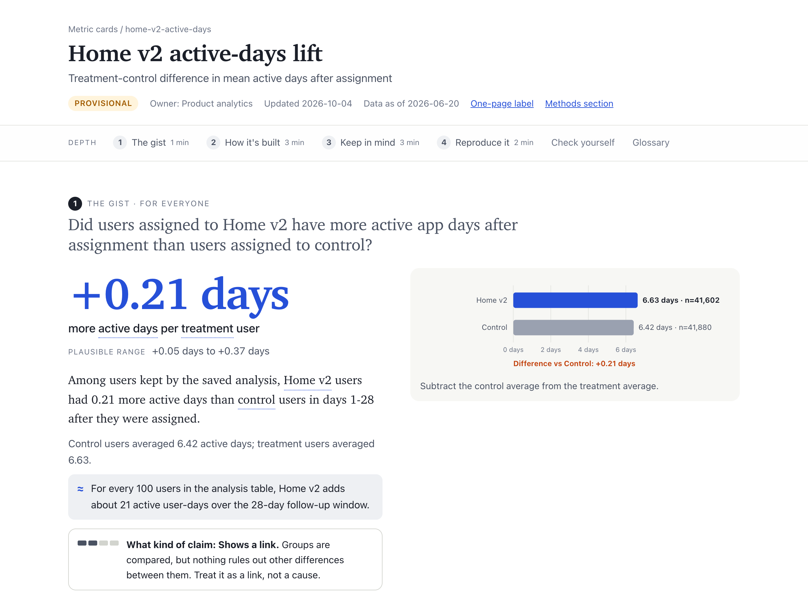

# data-visual-explainer

**Explain one number so non-specialists read it correctly and specialists can reproduce it.**

Point your AI agent at an analysis: a readout, the SQL or notebook behind it, a results table. The
agent traces the headline number to the code that produced it, records every place where the
write-up and the code disagree, and hands back a **Metric Card**, one source file rendered as an
interactive explainer, a one-page label and a methods section.

[](https://github.com/spunt/data-visual-explainer/actions/workflows/tests.yml)
[](LICENSE)

[](https://www.bobspunt.com/data-visual-explainer/site/home-v2-active-days.html)

**[Open the live demo](https://www.bobspunt.com/data-visual-explainer/site/)**: four cards, each a
single HTML file that works offline.

## At a glance

| | |
|---|---|
| **Use it when** | people misquote or misread a number; someone asks what a metric actually measures (who is counted, over what time window, what counts); you need to define or document a KPI, check a metric's written definition against its SQL or code, or write the methods behind a reported figure |
| **Not for** | building charts or dashboards, or persuasive slides and narratives |
| **You give it** | a folder with the analysis: readout, SQL or notebook, results table, any docs. The more of the pipeline it can read, the more it can check; with only a readout, it marks what it cannot verify instead of guessing |
| **You get back** | `cards/<id>.yaml`, the single source of truth, rendered as an HTML explainer, a one-page "Metric Facts" label and a Markdown methods section |
| **Runs in** | any agent that reads `SKILL.md` skills (tested in GitHub Copilot CLI; the same format is read by Claude Code, Codex and others), plus Python 3.11+ for the renderer |

## What it catches

A leadership readout for an A/B test said:

> Home v2 causes users to be active 0.21 more days a month (+3.3%). Because this is a randomized
> experiment, the effect is causal and applies to all new users.

The card the skill wrote, unedited, tells readers what to say instead:

> **Say:** "In the saved analysis, treatment users averaged 0.21 more active days than control users
> over days 1–28 after assignment."
> **Don't say:** "Home v2 caused all new users to be active 0.21 more days per month."

because the code did not do what its own documentation said:

| The write-up says | The code does |
|---|---|
| Intent-to-treat: every assigned user is analysed | Keeps only users who saw the new screen and had at least one active day |
| The result applies to all new users | Drops one country |
| Days are counted in each user's local time zone | Counts days in UTC |

(This is a synthetic analysis from the skill's blind evaluation; the fixtures and answer key are in
`eval/`.)

## Quick start

**1. Install the skill** for your agent:

```bash
# GitHub Copilot CLI
git clone https://github.com/spunt/data-visual-explainer ~/.copilot/skills/data-visual-explainer
# Claude Code
git clone https://github.com/spunt/data-visual-explainer ~/.claude/skills/data-visual-explainer
# Codex
git clone https://github.com/spunt/data-visual-explainer ~/.codex/skills/data-visual-explainer
```

For one project only, clone into `<repo>/.github/skills/` (Copilot) or `<repo>/.claude/skills/`
(Claude Code) instead. Claude Code can also install it as a plugin:
`/plugin marketplace add spunt/data-visual-explainer`, then
`/plugin install data-visual-explainer@data-visual-explainer`. To check the install, start a new
session and ask *"which skills can you use?"*; the answer should include `data-visual-explainer`.

**2. Install the renderer's three Python packages:**

```bash
python3 -m pip install pyyaml jinja2 jsonschema
```

If you skip this, the first `mcard` command prints the line to run.

**3. Ask your agent**, in a fresh session:

> Make a metric card for the headline number in `./analysis`.

Plain questions work too: *"What does the 4.1% click rate in ./analysis actually measure?"*

**You don't fill in any YAML.** The agent reads your files and writes the card, following
`SKILL.md`: pin the number, trace it to code, hunt for mismatches in both directions, write the
fine print, then the plain-language layers, then lint and render. It saves the card under `cards/`
and the pages under `site/`, then tells you which file to open.

**Review it like any analysis before you share it.** Read the explainer, then ask the agent for
changes; it edits the YAML (never the HTML), and `mcard lint` re-checks the arithmetic and
references on every rebuild.

## Four depths, one source

```
1 The gist        what it means, how big, how sure, the one caveat         everyone
2 How it's built  one worked example, then each rule with a live figure    the curious
3 Keep in mind    bias-direction caveats, misreadings, sensitivity         decision makers
4 Reproduce it    estimand, exact rules, code, doc-vs-code gaps, receipts  specialists
```

The plain-language layer is written *last*, after the facts are pinned to code, so the friendly
words cannot drift from the real rule. A linter checks the arithmetic, the references, the reading
level and the jargon before anything is rendered.

| File | For |
|---|---|
| `site/<id>.html` | The interactive explainer. One file, works offline, prints cleanly, keyboard accessible. |
| `site/<id>.label.html` | A one-page "Metric Facts" label for appendices and decks. |
| `site/<id>.methods.md` | A methods section to paste into a report, wiki page or paper. |

## Examples

| Card | Kind | What the documentation-vs-code audit found |
|---|---|---|
| [Home v2 active-days lift](https://www.bobspunt.com/data-visual-explainer/site/home-v2-active-days.html) | A/B test, synthetic | Claimed intent-to-treat; the code keeps only exposed users with at least one active day, drops a country and counts days in UTC |
| [PixelPress trial conversion](https://www.bobspunt.com/data-visual-explainer/site/pixelpress-trial-conversion.html) | Conversion rate, synthetic | A 30-day conversion window that the code sets to 14 days; a cohort end date one day late; test accounts and refunds the write-up says are excluded but the code keeps; an undocumented first-trial-only rule |
| [Fast-food jobs after New Jersey's 1992 minimum-wage rise](https://www.bobspunt.com/data-visual-explainer/site/minimum-wage-did.html) (Card & Krueger 1994) | Difference-in-differences, public data | A "unique" store id used twice; closed stores zeroed in the data, not the code; a published t statistic whose method is not stated, where the obvious formula gives a range that includes zero |
| [Weight gain from quitting smoking](https://www.bobspunt.com/data-visual-explainer/site/smoking-cessation-ipw.html) (Hernán & Robins, *What If*, ch. 12) | Inverse-probability weighting, public data | Eligibility rules described in the book but applied before distribution; a model refit the text does not mention |

The two synthetic cards are the skill's unedited output from a blind evaluation. The two public
cards reproduce the published numbers from the authors' own files; the data are downloaded, not
redistributed:

```bash
python examples/fetch_data.py all        # checks the SHA-256 of every file
python examples/minimum-wage/analysis.py
python examples/nhefs-ipw/analysis.py
bin/mcard build cards -o site
```

## Use it without an agent

```bash
M=path/to/data-visual-explainer/bin/mcard
$M new my-metric --dir cards             # cards/my-metric.yaml from the template
$M lint cards/my-metric.yaml             # fails until every TODO is replaced
$M build cards -o site                   # explorer, label, methods, index
open site/my-metric.html
```

A metric that has not been run yet gets a **definition-only** card: omit the headline and set
`results.status: not_run`.

## Does it work?

The evidence is small, and `eval/REPORT.md` says exactly how small:

- **Accuracy.** In 4 runs on two synthetic analyses with planted documentation-vs-code gaps,
  graded blind against answer keys: no invented numbers and the right headline every time. The
  current version found every planted gap (5 of 5, and 4 of 4); earlier versions missed one subtle
  one. A strong model given the same brief without the skill found 4 of 5 and 4 of 4.
- **Readers.** Simulated non-specialist readers (AI personas: a pre-screen, not people) who read
  only the first layer answered 6 of 6 key questions correctly, against 3.5 of 6 for that
  no-skill baseline. So on accuracy the skill roughly ties a strong model; its measured gain, so
  far only with simulated readers, is in what a skimming reader takes away.
- **Not done yet.** Comprehension tests with real people. The protocol is in
  `docs/evaluation.md`; until a card passes it, treat its plain-language layer as a draft.

A further case on internal data is withheld; the report marks its rows.

## What the linter catches

Placeholders left in; broken references; a headline that disagrees with the group numbers;
outcome windows not yet fully observed; jargon without a glossary entry; overlong or
hard-to-read definitions; missing claim strength, ATT/ATE target or interval caveats; quiz
coverage gaps. See `docs/content-model.md` §4.

## Layout

| Path | Role |
|---|---|
| `SKILL.md` | The authoring procedure the agent follows |
| `schema/metric_card.schema.yaml` | The card format |
| `schema/card_template.yaml` | Starting point for `mcard new` |
| `cards/` | The example cards |
| `site/` | The example cards, rendered (the live demo) |
| `examples/` | Download script and analysis code behind the two public cards |
| `mcard/` | Loader, linter, SVG figures, renderer, CLI |
| `bin/mcard` | CLI wrapper usable from any directory |
| `docs/content-model.md` | Why each layer and field exists, with evidence |
| `docs/evaluation.md` | How to test a card with real readers |
| `eval/` | Frozen evaluation: synthetic fixtures, answer keys, runs, grades, `REPORT.md` |
| `tests/` | `python -m pytest -q` |
| `tools/shoot.py` | Screenshots and interaction checks in local Chrome |
| `.claude-plugin/` | Claude Code plugin and marketplace manifests |

Requires Python 3.11+, `pyyaml`, `jinja2` and `jsonschema`. The public examples also need
`pandas`, `numpy` and `statsmodels`; `tools/shoot.py` needs `playwright` and a local Chrome. Agents
need nothing more than the three packages and `bin/mcard`. To work on the tool itself, or to get an
`mcard` command on your PATH: `pip install -e ".[dev,examples]"` from a checkout (editable,
because the tool reads `schema/` from the checkout).

## Known limits

- The window model uses fixed offsets from each unit's time zero. Designs where follow-up length
  varies by unit (the smoking example) cannot state completeness, so the linter warns.
- One metric per card. Slack, slide and dashboard versions of a card are not built yet.

## License

Code and documentation: Apache License 2.0 (see `LICENSE` and `NOTICE`). The public examples'
source data belong to their authors and are downloaded from their sites at run time; they are not
covered by this license.
